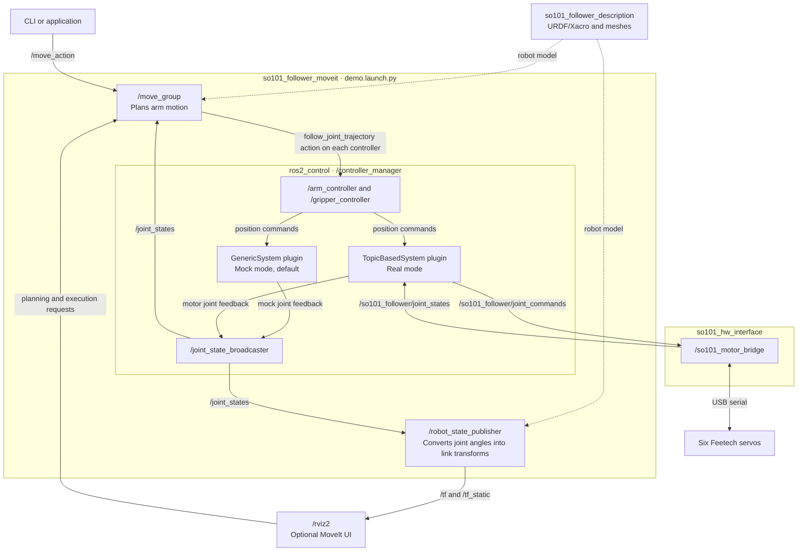
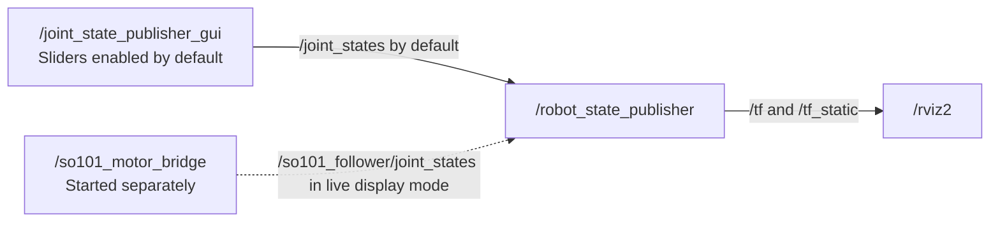

# SO-101 ROS 2 node diagrams

The three SO-101 packages cover the robot model (`so101_follower_description`), motion planning and control (`so101_follower_moveit`), and serial communication with the motors (`so101_hw_interface`). The diagrams reflect the launch files and configuration in the Jetson workspace.

## MoveIt demo

The launch selects one hardware plugin. With `use_fake_hardware:=true`, `GenericSystem` supplies mock joint feedback. With `use_fake_hardware:=false`, the launch waits for the bridge's first joint-state message before starting the trajectory controllers. The bridge publishes calibrated motor angles on `/so101_follower/joint_states`, and the broadcaster publishes `/joint_states` for MoveIt and the robot state publisher. [Demo launch](../jetsonNano/ros2_ws/src/so101_follower_moveit/launch/demo.launch.py) · [Hardware plugin configuration](../jetsonNano/ros2_ws/src/so101_follower_moveit/config/so101_follower.ros2_control.xacro) · [Motor bridge](../jetsonNano/ros2_ws/src/so101_hw_interface/so101_hw_interface/motor_bridge.py)

## Standalone model display

- `so101_follower_description/display.launch.py` previews the model in RViz. To display the real pose from an already-running bridge, pass `use_gui:=false joint_states_topic:=/so101_follower/joint_states`. [Display launch](../jetsonNano/ros2_ws/src/so101_follower_description/launch/display.launch.py)
- `so101_hw_interface/so101_hw.launch.py` starts `/robot_state_publisher` and `/controller_manager` with its standalone controller configuration. The hardware package also provides the `/so101_calibrator` utility node and the `so101_read_steps` command for reading encoder counts directly over serial. [Hardware launch](../jetsonNano/ros2_ws/src/so101_hw_interface/launch/so101_hw.launch.py) · [Executable definitions](../jetsonNano/ros2_ws/src/so101_hw_interface/setup.py)
